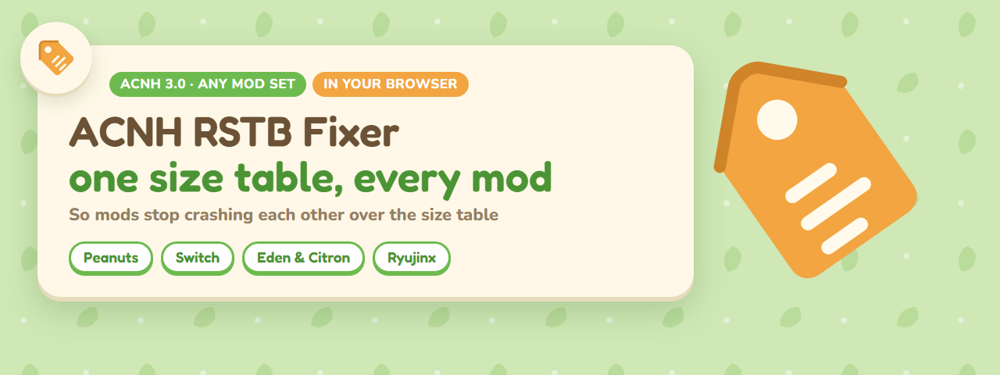

# ACNH RSTB Fixer



Mods for Animal Crossing: New Horizons 3.0 that crash together often just need one size table that fits them all. The [page](https://catmona.github.io/acnh-rstb-fixer/) makes that table from your own mods, right in your browser, and gives it to you as a small mod laid out for where you play. Nothing is uploaded.

> [!NOTE]
> **How this was made:** Claude (Anthropic's AI, through Claude Code) worked out the size rules and wrote the page, the checks and the docs. I decided what to build and tested it on my AYN Thor, but I haven't reviewed the code line by line, so assume any part of it may be AI-written.

## Why mods crash together

The game keeps a table of how much memory each file needs (`romfs/System/Resource/ResourceSizeTable.srsizetable`) and refuses any file bigger than its entry. Only one copy of the table is used. So a mod that changes models or messages can crash when another mod's table wins, for example a grass recolor (`Model/FldUnit.Nin_NX_NVN.zs`) next to Jubbsticks' Additions.

## Use it

1. Open the [page](https://catmona.github.io/acnh-rstb-fixer/) and add every mod that changes game files (the ones with a `romfs` folder): `.zip` or `.7z` files, or on a PC a mod folder or your whole mods folder. For a `.rar`, extract it first.
2. Pick where you play.
3. Hit **Make my size table** and download the zip. The page shows the steps to install it for where you play.

Make it again whenever you add, remove or update a mod. If none of your mods has a size table, the page asks for the one from your own game dump (`romfs/System/Resource/`).

Playing QoL Enhancements or Jubbsticks' Additions on Peanuts? Their patcher pages ([QoL](https://catmona.github.io/acnh-qol-peanuts/), [Jubbsticks](https://catmona.github.io/acnh-jubbsticks-peanuts/)) make this table for you, with the same code.

## Where you play

Only one copy of the table counts, so the table mod has to be the copy the game picks. Each platform picks differently, and the page gives the steps for the one you choose (`PLATFORMS` in `lib/mods.js`).

| Platform | Which copy of a file wins | The table mod |
| --- | --- | --- |
| Peanuts (Android) | the first-installed mod's, and the order can't be changed | `atmosphere/contents/01006F8002326000/romfs/...`. Install it first, then your other romfs mods again |
| Switch (Atmosphère) | every mod shares one folder, so the last file copied there | same path. Copy it to the SD card after your other mods |
| Eden, Citron, Sudachi and other yuzu forks | the first mod folder by name | `00 Size Table/romfs/...`, which sorts before other names |
| Ryujinx (Ryubing) | the first mod folder in the order the OS lists them | `00 Size Table/romfs/...`. On Windows that comes first. On Linux and macOS, delete the other mods' tables |

Ryujinx: read in `ModLoader.cs` (Ryubing, commit eaff2d33, Nov 23, 2026). `AddModsFromDirectory` walks folders with `EnumerateDirectories()` and doesn't sort them, so the order is whatever the file system gives. NTFS lists by name, and Linux and macOS file systems have no fixed order. In `AddFiles` the first copy of a file wins (`fileSet.Add`), and loose `romfs` folders come before `romfs.bin`. Mods are turned on and off in `games/<title id>/mods.json`.

A picked folder can be one mod or a whole mods folder (a yuzu or Ryujinx mods folder, an SD card's `atmosphere/contents`, a copy of Peanuts' mods folder). Every folder named `romfs` is read as one mod. Mods for other games, and mods whose `mod.json` says `"enabled": false`, are left out.

## How it works

1. It starts from the size tables the mods include and takes the larger size where they differ. If no mod has one, it uses the table from your own game dump.
2. It sizes every romfs file in the mods. Each rule below was read off vanilla 3.0.3's own table and files, and `n` is the decompressed size rounded up to 32.

| Files | Entry | Vanilla files matched |
| --- | --- | --- |
| `Message/` archives | n + 512 | 22 of 22 exactly |
| Texture-only models (one BFRES with no models, one BNTX) | n + 9,248 + 16 per texture | 3,337 of 3,337 exactly |
| `Layout/` | n + 8,192, plus a 512 margin | none smaller than vanilla |
| `Font/` | n + 8,192 | none smaller than vanilla |
| `Sound/*.bars` | n + 712, plus a 64 margin | none smaller than vanilla |
| `Bcsv/`, `EventFlow/`, `AnimationSequence/` | n + 416, plus a 32 margin | none smaller than vanilla |
| Models with geometry, collision or physics | entry removed: the game sizes the file itself | - |
| Everything else (Param, Stage...) | vanilla has no entries for these, so nothing changes | - |

   The margins cover the few vanilla entries that sit above the rule: up to 376 bytes (2 layouts), 32 (11 sound banks) and 16 (1 flow). An entry is only ever raised, never lowered.

3. It writes the table as `RSTC` (3.0) or `RSTB` (2.x), whichever the base was, Yaz0 store-only. The game reads that fine.
4. It puts the table in its own small mod, laid out for where you play, so it wins over the tables in your other mods.

Why geometry models lose their entry: their load size depends on GPU buffers set by the shaders, so no simple rule fits. Universal RSTB (GameBanana 498070) removes the entries for all 58,613 vanilla model files, and the game sizes them itself. The Jubbsticks port also loads 529 models that have no entry. This tool removes only the entries for models your mods include.

## Checked in game

On an AYN Thor (Peanuts Native 0.1.8, ACNH 3.0.3, Nov 25, 2026), the Jubbsticks 3.0.3 port was the only romfs mod, with the memory fix code mod. Its table was rebuilt on vanilla 3.0.3's: 48 entries raised, 695 geometry entries removed, 66,167 entries. The launch log's `DM_ROMFS_OVERLAY` showed the port was loaded.

| Check | Rebuilt table | Port's own table |
| --- | --- | --- |
| Boot to title | pass | not run |
| Load an existing island | pass | not run |
| Walk outdoors | pass | not run |
| New save: intro at the Nook Inc. counter, not a black screen | pass | pass |
| Resident Services, Nook's Cranny, a house, the Roost | not tested: the test island is still at the tent stage | not tested |

There were no crashes with either table. The new save was only followed to the airport counter, not through island generation. The port's own table only got the new-save check, because the rebuilt table passed everything else.

The first run proved boot and load only, because no model with a removed entry was on screen. Of the 695 removed, 677 are the port's `Model/Layout_*` menu and cooking icons. The other 18 are the Roost (`IdrMuseumCafe00`), pansies, roses, the six wooden and flimsy tools and 8 fruit and petal icons.

A second run (Nov 26) equipped the flimsy fishing rod. That is `Model/ToolFishingrodWood`, a vanilla model the port replaces, and its entry is removed. It drew correctly in hand, and the port ran about 5 minutes with no crash. So one removed entry is checked in game. The pocket icons that showed (weeds, branch, the rod) are not removed entries. That run's frame rate isn't evidence for or against the table: the Thor was at 1% battery, which caps the GPU.

A third run (Nov 26, 7:05 to 7:08 PM) used the table the way the page gives it: the table-only mod installed first, then QoL Enhancements 1.1.0 (no table), the Jubbsticks port (with its own table, which has to lose) and the memory fix. The table came from the page's code over those mods. The launch log's `DM_ROMFS_OVERLAY` listed the table mod first and the port last, so the table mod's copy is the one the game reads. Boot to title, loading the island, walking outdoors and the pocket (bell counter and items) all passed, with no crash, at 34 fps. Peanuts builds no merged table, so the file the game opened wasn't hashed: the evidence is the overlay order and the port running. The tool ring, fruit and QoL's catalog screens weren't reached.

## Not yet checked

- In game, the other removed entries: fruit on the ground and in the pocket, the tool ring and cooking menu with port items, the other wooden tools, pansies and roses, and the Roost. Also buildings and interiors, and a new save past the airport counter. The Universal RSTB page reports a black screen when starting a new save with every model entry removed.
- A mod that changes a geometry model (the grass case, `Model/FldUnit.Nin_NX_NVN.zs`) next to the port.
- 2.x (`RSTB`) tables: the layout is read and checked against the header length, but the rules were only fitted on 3.0.3.
- The table as its own mod on Peanuts: run once (above) through boot, island and pocket. The screens QoL changes (catalog, Nook Shopping) weren't opened.
- Switch, the yuzu forks and Ryujinx: nothing has been tested on them. Their steps come from how each one picks a file (Ryujinx from its source, above), not from a run.

## Use it from another page

The QoL and Jubbsticks patcher pages use this repo as a git submodule (at `docs/rstb`) and rebuild the table over every mod the player uses. A page loads one file and then makes one call:

```html
<script src="rstb/lib/page.js"></script>
```

```js
const R = await ACNH_RSTB.load();   // loads formats.js, the zstd decoder, rstb.js and mods.js from next to page.js
const mods = [await R.readMod('mod.zip', bytes) /* , ...(await R.folderMods(top, [[path, get]])).mods */];
const r = await R.buildTableMod('peanuts', mods, baseTableOrNull, d => R.fzstd.decompress(d));
// r.mod = { name, entries: [[path, bytes]], steps, label }; R.writeZip(r.mod.entries) is the zip. r.summary, r.notes, r.rows.
```

Everything goes on `self.ACNH_RSTB` only, so nothing clashes with the page's own names. Under Node, `require('./lib/mods.js')` and the others work as before. `buildTableMod` throws if no mod has a table and no base is given.

## Checks

```
node test/check-vanilla.mjs <vanilla ResourceSizeTable.srsizetable> <vanilla romfs dir>...
node test/rebuild.mjs [--base <table>] [--mod <peanuts|switch|yuzu|ryujinx>] --out <file> <mod .zip|.7z|folder>...
node test/check-fit.mjs <table or table mod .zip> [--vanilla <table>] <mod .zip|.7z|folder>...
```

`check-vanilla` round-trips the table (byte-identical for 3.0.3) and fails if any rule comes out smaller than vanilla. `rebuild` runs the same code as the page, and with `--mod` writes the table mod's zip. `check-fit` (the same `checkFit` the patcher pages' checks use) fails if any copy of any file in the mods needs more than its entry, a geometry model still has an entry, or an entry of vanilla's table or a mod's own table came out smaller.

Last run, Nov 26, 2026: `rebuild --base` vanilla 3.0.3 `--mod peanuts` over the QoL Enhancements 1.1.0 download, the Jubbsticks patcher's zip and ACNH Combined 3.0.3 gave 64,596 entries in 1.3 s, and all four platforms wrote their zip. `check-fit` on it passed: 138 files sized, 1,275 geometry models with no entry, 0 entries lowered against vanilla, Jubbsticks or Combined. `check-vanilla`'s round trip is still byte-identical. Its rule half was not re-run after the lib was wrapped for `lib/page.js`, because the full 3.0.3 romfs wasn't on hand. That change didn't touch the rule code.

The page itself, in headless Chrome (Nov 26, 2026): the same three mods for Peanuts gave the same 64,596 entries in 1.5 s, and the Jubbsticks zip alone for Switch gave 64,663. With only the QoL download (no table anywhere) the page says so and opens the box for your game's own table. On an Android phone it has no folder button.

## Files

- `index.html`, `app.js`: the page, in the same look as the QoL and Jubbsticks patcher pages
- `lib/page.js`: the one file other pages load (see above)
- `lib/rstb.js`: table format, size rules, rebuild, `checkFit`
- `lib/mods.js`: reading mods and mods folders, the platforms and their steps, the table mod, `buildTableMod`
- `lib/formats.js`: zip, 7z, Yaz0 and CRC32, from acnh-jubbsticks-peanuts (same author)
- `test/`: the checks above
- `tools/make_art.py`: renders `img/banner.png`
- `vendor/fzstd.umd.js`: zstd decoder (MIT, see `vendor/fzstd.LICENSE`)

## Credits

The Universal RSTB page (GameBanana 498070) for the idea of letting the game size models itself, the Ryubing team for Ryujinx's readable mod loader, and 101arrowz for fzstd.

Fan-made, not affiliated with Nintendo.

## License

GPL-2.0, see `LICENSE`.
